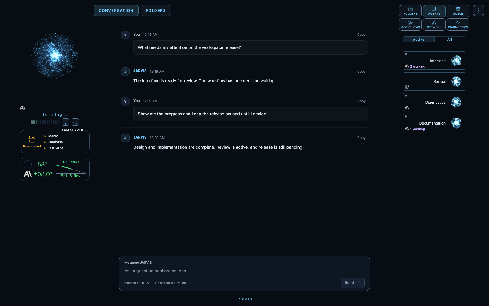
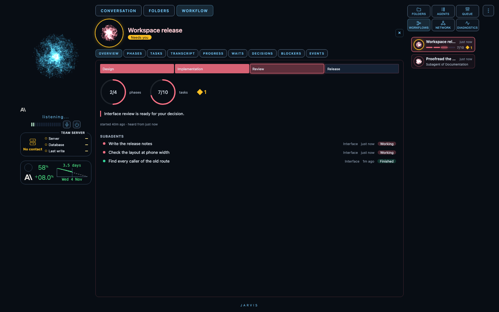
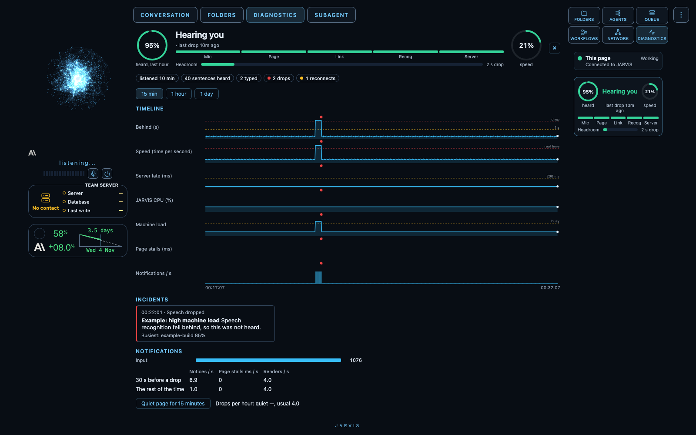

# JARVIS

**A voice-first workspace for conversations, coding agents and the work they share.**

JARVIS brings spoken and typed conversation, agent threads, workflow decisions and voice diagnostics into one interface. It runs on macOS and connects to Claude Code and Codex. This repository is the Prototype Engine: a place to develop the interaction and coordination needed for the future Denice system.

The development direction is the new React workspace. Start with the [roadmap](docs/roadmap.md) for what comes next and [what's new](docs/whats-new.md) for the current interface.

## Where the project is going

### One workspace for supervising work

Conversation is the centre of the experience. The next focus is making it easy to move from a discussion to a recorded request, follow that request through an agent's work, answer a decision and understand the result. Agent threads and workflow details belong beside the conversation, with concise status and deeper evidence available when needed.

### Voice that keeps up with the whole machine

Voice reliability means hearing complete commands while the browser, coding agents and speech output are active. The next focus is measurable performance across capture, transport, recognition and playback, backed by diagnostics that explain failures. Notification volume and browser workload are part of that investigation.

Speech-output alternatives remain under evaluation. A local model must meet the accepted voice quality and leave enough capacity for listening; installing a model is not evidence that it can replace the current Fish voice. Current speech recognition is local, while Fish output and the conversational providers retain their network dependencies.

### Coordination across agents and providers

The direction is durable, understandable work state: which agent received a message, what it is doing, what is blocked and which decision is needed. Provider choice should preserve the same conversation and supervision workflow. A change of conversational brain should not be confused with a change of development executor.

### The path to Denice

Denice, pronounced Denise, is the successor direction. The planned progression moves from this Prototype Engine to the Parris Island Engine, then Bridge and Proteus. Those stages introduce the new Denice system, Agent Guardrails and the longer-term AI OS architecture. They are planned product stages, not capabilities already supplied by this repository. A rebrand alone does not implement them.

The [full roadmap](docs/roadmap.md) separates current capabilities, next development focus, evaluations and future engines. It makes no release-date commitments.

## The new interface today

| Area | What it contains |
|---|---|
| **Conversation, in the centre** | Conversation history, live spoken words, typed input, captures and sources. Open an agent thread, a workflow or detailed diagnostics here. |
| **Voice and brains, on the left** | The audio-reactive orb, voice status, microphone controls and brain account usage. |
| **Work, on the right** | Agents, Diagnostics and Workflows tabs. Select an agent or a workflow to inspect the work in context. |
| **Settings** | Brain providers, voice and other application configuration. |

Workflow details include phases, tasks, progress, attached transcripts, waits, blockers, decisions and events. Voice diagnostics show pipeline health and incident history, with notification analysis and a quiet-page comparison. See [what's new](docs/whats-new.md) for a short guide.

Choose **Classic Refined** or **Graphite** in Settings → System → Appearance.
Both cover the workspace and run dashboard while preserving their layout and
controls. The choice stays in this browser and applies on reload.

These are fresh captures of the actual React interface, rendered with fictional conversation, workflow, agent and diagnostic data. They do not show a live account or production measurements.

### Conversation and agents



### Workflow progress and decisions



### Voice diagnostics



Regenerate these captures with `.venv/bin/python scripts/capture_docs.py`.

## Install

One command takes a fresh Mac or Windows 11 PC to a running JARVIS. It checks the tools JARVIS needs, lists what is missing and asks once before installing anything, sets the checkout up, runs JARVIS's own preflight and can start it. A second run changes nothing that is already right and says so.

**macOS** (Terminal):

```bash
curl -fsSL https://raw.githubusercontent.com/4thWAIV/jarvis/main/install.sh | bash
```

**Windows 11** (PowerShell):

```powershell
powershell -NoProfile -ExecutionPolicy Bypass -Command "& ([scriptblock]::Create((irm https://raw.githubusercontent.com/4thWAIV/jarvis/main/install.ps1)))"
```

Either one clones the repository first (`~/jarvis` on macOS, `%USERPROFILE%\jarvis` on Windows, never directly under `C:\`) and carries on from inside it. Flags go after the command: `bash -s -- --yes --start`, or `... (irm ...)) -Yes -Start`. From a checkout you already have:

```bash
./install.sh
```

```powershell
powershell -ExecutionPolicy Bypass -File .\install.ps1
```

| macOS | Windows | Does |
|---|---|---|
| `--check` | `-Check` | Only check and report; installs and changes nothing. Exits 1 if anything required is missing. |
| `--yes` | `-Yes` | Answers yes to the one question, for unattended runs. |
| `--no-models` | `-NoModels` | Skips the speech and embedding model downloads (about 55 MiB and 135 MB); Settings installs them later. |
| `--start` | `-Start` | Starts JARVIS when done and opens Chrome (`--no-open` / `-NoOpen` skips Chrome). |
| `--dir DIR` | `-Dir DIR` | Where to clone when run outside a checkout. |

**What it installs** when missing or too old: on macOS the Xcode Command Line Tools (git; Apple's own installer window), Homebrew (only if something must go through it), Python 3.12, Node.js 22 with npm, Google Chrome, openssl and Claude Code 2.1.224 or newer; on Windows, through winget, Git for Windows (which brings openssl), Python 3.12, Node.js 22 LTS, Google Chrome and Claude Code (as `claude.exe`). Codex is optional and only reported. In the checkout it makes `.venv`, installs the Python and frontend dependencies, makes the development certificate, installs Playwright's Chromium and the two models, and installs the talk-to-jarvis skill; each step is skipped when already done. Every command's output is kept in `install.log` in the checkout. It never reads or writes a key, token or password and never creates a `.env`.

**Exit codes:** 0 all good; 1 something required is missing or was declined; 2 an install step failed; 3 JARVIS did not start; 64 bad usage.

**What only you can do**, listed at the end of the run:

1. Sign in to Claude Code: run `claude`, then `/login` with your Claude subscription. JARVIS never uses an API key.
2. Enter the Fish Audio key (from fish.audio) in Settings, Voice. It is never typed on a command line or kept in a file.
3. On macOS, grant your terminal Accessibility: System Settings, Privacy & Security, Accessibility.
4. Allow Chrome's microphone for `http://localhost:5173`. Permissions are per origin, port included.

Start, check and stop afterwards with `.venv/bin/python -m jarvis.background start|status|stop|logs` (`.\.venv\Scripts\python.exe` on Windows; see the [Windows README](docs/windows.md)).

### Manual setup

Use macOS or Windows with Chrome; the microphone path is tested in Chrome. Python 3.11+ (3.12 recommended) and Node.js 22 are needed for development. Choose Fish Audio or local Kokoro CPU speech in Settings, Voice; see [local voice setup](docs/local-voice.md). Without working synthesis, replies remain visible as text. Every setting is chosen in Settings; nothing asks you to edit a `.env` file.

```bash
python3 -m venv .venv
.venv/bin/pip install -r requirements.txt
npm --prefix frontend ci
.venv/bin/python -m jarvis.background certs
.venv/bin/python -m playwright install chromium
.venv/bin/python scripts/setup_speech_input.py
.venv/bin/python scripts/setup_embedding_model.py
.venv/bin/python -m jarvis.session_skill install
.venv/bin/python -m jarvis.background start
```

`certs` makes the certificate the Vite development proxy needs (the same as `openssl req -x509 -newkey rsa:2048 -keyout key.pem -out cert.pem -days 365 -nodes -subj '/CN=localhost'`). `start` runs the backend and Vite in the background; to run them in the foreground, use `.venv/bin/python -m jarvis` and `npm --prefix frontend run dev` in two terminals. Open **http://localhost:5173** in Chrome and click the page to enable audio. The development proxy expects the backend at `https://localhost:8340`. On Windows, follow the [Windows README](docs/windows.md).

The first time the page loads without a voice, Settings opens on Voice for the Fish Audio key. Claude uses the Claude Code subscription login; the Codex brain uses its own application-managed Codex home (see the provider controls in Settings). Fish Audio is a separate service with its own usage charges. See the [setup guide](jarvis/skills/jarvis-setup/SKILL.md) for authentication, permissions and troubleshooting.

## Implementation and data

The Python application lives in `jarvis/`; the React and TypeScript interface lives in `frontend/src/`. `python -m jarvis` starts the service. Frontend builds are written to `jarvis/web` for packaging.

```text
Microphone → local recognition → conversation → Claude or Codex brain
Typed input ────────────────────────┘                 │
                         tools, agents and workflows ←┤
                                  Fish Audio output ←┘
```

Recognition currently uses Kroko through sherpa-onnx. The model and runtime are defined in [jarvis/transcriber.py](jarvis/transcriber.py). Speech scheduling and synthesis are separate components; the brain provider interface is in [jarvis/brain_provider.py](jarvis/brain_provider.py).

SQLite records and Markdown memory live under `data/` in a checkout. `JARVIS_DATA_DIR` selects another data directory. An installed copy keeps configuration and data under `~/Library/Application Support/JARVIS`. MCP connections are configured through the brain home's `connections.json`; the setup guide explains the format.

The service binds to loopback by default. Host/origin checks, internal tool tokens and each agent's own signing key (with its rights) protect specific application boundaries. Development runs can have full user privileges: Settings, Agents, "Runs skip permission prompts" (`skip_permissions`) is on by default. The foreign-content action refusal is opt-in in Settings, Safety, "Refuse to act after reading others' words" (`refuse_untrusted_actions`). These controls are not a universal sandbox or transactional rollback system. See [jarvis/web_auth.py](jarvis/web_auth.py), [jarvis/agent_rights.py](jarvis/agent_rights.py) and [jarvis/run_executor.py](jarvis/run_executor.py) for their implementation.

## Development

```bash
.venv/bin/python -m pytest
.venv/bin/python -m pytest -m page
npm --prefix frontend run build
```

The default suite excludes tests marked `page` or `browser`. The page suite builds and exercises the interface in headless Chromium. Tests marked `browser` use live browser/network integration and must be run explicitly. Avoid fixed test counts in documentation; the suite changes with the application.

See [CONTRIBUTING.md](CONTRIBUTING.md) for contribution guidance and [CLAUDE.md](CLAUDE.md) for implementation conventions. Start proposed work from the roadmap and distinguish new capability from experiments and release commitments.

## License

Free for personal, non-commercial use. Commercial use requires a license —
visit [ethanplus.ai](https://ethanplus.ai) for inquiries. See
[LICENSE](LICENSE) for details.

## Credits

Built by [Ethan](https://ethanplus.ai). Uses [Claude Code](https://claude.com/claude-code) or Codex for conversation and [Fish Audio](https://fish.audio) for speech output.

Inspired by the AI that started it all — Tony Stark's JARVIS.

> **Disclaimer:** This is an independent fan project and is not affiliated
> with, endorsed by, or connected to Marvel Entertainment, The Walt Disney
> Company, or any related entities. The JARVIS name and character are property
> of Marvel Entertainment.
