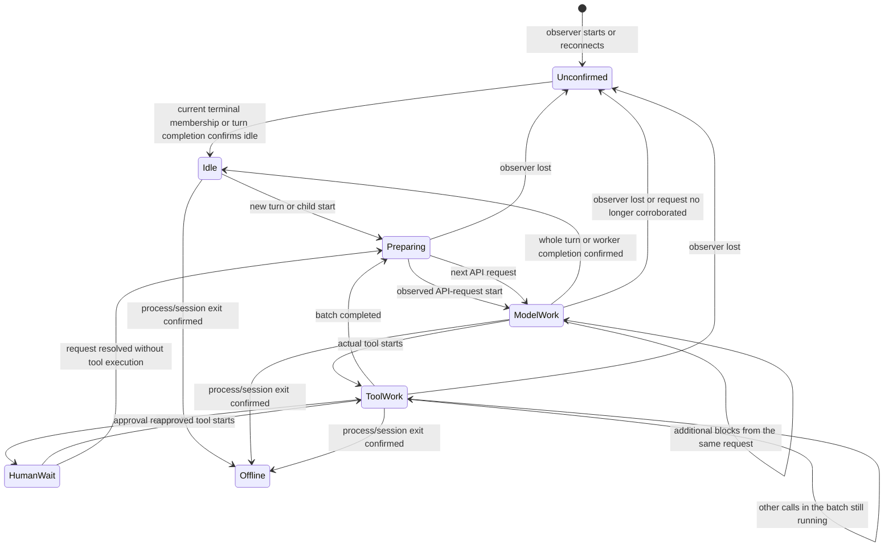

# UI agent status — native worker activity

## Direction and status

Keep Claude's own delegation and existing terminal sessions. The earlier proposal to replace native subagents with separately hosted workers is withdrawn. No replacement execution host is required by this plan. The independent inventory, Codex runtime adapter and reserved brain-slot UI remain on this branch, not deployed. The activity reducer and native telemetry described below still need implementation; this document does not claim that they are already running.

## What the human should see

The headline answers: how many workers are doing model work, how many are executing tools, and how many cannot currently be measured? Each worker remains visible under its parent or project. An assigned or loaded slot is not model work. A workflow is a container; its executing workers are counted once, not again as workflow agents. A parent's count includes its descendants but the global count uses unique workers.

Use `Model work 3 · Tools 2 · Unconfirmed 1`, with per-provider totals in the existing brain slots and all-provider totals in the opened inventory. Model work means a worker is in a model-request phase. It includes possible provider queueing or network wait. It is not a literal instantaneous count of backend tokens. A separate recent-output indication can show that chunks actually arrived. It must not convert a completed response into a claim of continuous generation.

This makes two independent facts visible: the last measured phase and whether its observation channel is healthy. For example, `Model request · 23 seconds · no output yet` is different from `Tool running · tests · 23 seconds` and from `Unconfirmed · last model request 4 minutes ago`.

## Native evidence found

A read-only inspection of eight recent Claude native-child transcripts found `agentId`, `sessionId`, `api-request.id`, and assistant `requestRef`. Of 2,190 assistant blocks, 2,189 linked to an API-request record; 964 reused a request reference because one request produces several blocks. Recorded request-to-block delay ranged from 0.838 to 83.68 seconds. These are completed historical intervals, not a measurement of present generation or a latency guarantee.

Fourteen thinking blocks carried `stop_reason: end_turn`, as did 71 text blocks. In one inspected request, a thinking block was followed by a text block almost fourteen seconds later. Therefore the existing `_finished` and activity reducer can prematurely call a child finished when only its thinking block has completed. Fix that before using their result for the new count. A model stop reason copied onto a block is not sufficient evidence that the whole worker has stopped.

Thirty recent child sidecars also carried a boolean `finished` field, all true in that historical sample. Five depth-two children carried `parentAgentId`; the others were depth one. The current `read_agent_meta` reads parent identity but ignores `finished`. Use the native completion marker when it belongs to the current execution episode, rather than guessing from a thinking block. A later request supersedes an older finished marker; false or absent does not prove liveness.

The inspected user settings install only `UserPromptSubmit`, not the complete lifecycle observer. Current native CLI visibility must therefore report that hook coverage is absent. The roster's busy state may aggregate children: the existing `session_status` code already records that the parent may be at its prompt while its background child works. Never assign a child's work to that parent.

## Observation without changing delegation

Add a neutral, local native-hook recorder. It writes only worker identity, lifecycle kind, tool-call ID/name, event time and receipt time. It returns no decision or injected context. Observe child start/stop, tool start/end/failure, batch completion, turn submission/end/failure, approval waits and session end. Preserve existing hooks. Register globally for the supported installation so Planning, Diagnostics, Bridge, Render and other native sessions are covered regardless of project. Mark a session covered only after its recorder handshake is observed; configuration on disk alone is not proof that an already-running session loaded it.

Tail each actual child transcript incrementally, retaining inode/offset and complete-line handling. Use request IDs and references, not content matching. Validate supported record versions, retain only lifecycle metadata, and recover from truncation, rotation and restart. This covers children launched before hook registration and identifies model-request boundaries that hooks do not expose. Parent PID existence proves the process is alive, not that each child is doing model work.

Claude hooks provide lifecycle and per-agent tool context. The streaming SDK also supplies native task start/progress/completion and background membership. Its partial model stream covers the main worker; native child token deltas are not forwarded. Use that distinction, rather than replacing delegation. Sources: [hooks](https://code.claude.com/docs/en/hooks), [streaming output](https://code.claude.com/docs/en/agent-sdk/streaming-output), [SDK event types](https://code.claude.com/docs/en/agent-sdk/typescript).

## One phase per worker, evidence beside it

A start-of-request record measures that a request was recorded. Classify its interval as model work with `basis=request_boundary`, not `generation_confirmed`. A stream delta measures recent output with its own receipt time. While awaiting the first response, show request age. If a turn-end hook is only an attempted stop because another hook may continue execution, retain `finishing/unconfirmed` until a current native finished sidecar, terminal completion, current membership or the parent receives its child result; a new request immediately resumes model work. Never treat task creation, tool-result arrival, transcript modification time or a live PID as proof of generation.

Keep the set of outstanding tool-call IDs. Finishing one of several parallel calls does not move the worker back into model work. A synchronous Agent tool may keep the parent in tool work while its native child does model work; count the child in the model total and the parent in tools. A background child may continue after its parent becomes idle. Failed requests, permission waits, cancellation and stop-sequence endings need explicit transitions rather than arbitrary idle timeouts.

## Coverage across worker types

| Worker | Primary observation | Parent/dedup rule | Remaining uncertainty |
|---|---|---|---|
| JARVIS brain | Existing request/stream/tool events | One record per actual provider execution | No backend token truth between chunks |
| Claude named CLI | Native hooks, roster, own request transcript | Provider plus session ID | Old sessions may not yet load hooks |
| Claude native child or teammate | Child hooks and own request transcript | Agent ID under session/parent; no re-hosting | Missing stop, parent metadata or request schema stays visible |
| JARVIS managed Claude run | Existing partial stream and task events | Same session ID as roster; children separate | Child deltas unavailable; request phase is still observable |
| Codex app-server worker/child | Existing runtime observer, model/item/tool lifecycle | Thread ID and parent thread metadata | Active runtime alone does not establish model work |
| Standalone Codex CLI | Its native turn/tool/output transcript | Session/parent metadata | No runtime connection means weaker coverage |
| Workflow worker | Actual execution identity from the above | Workflow membership annotates that identity | Missing worker reference is a gap, not zero |
| Reserved slot or queued run | Existing capacity/queue records | Not a token-consuming worker | Unreported external reservations remain unknown |

## Freshness and detection latency

The existing SessionWatcher defaults to a one-second interval after each discovery cycle. The new UI polls one second after each response. Thus the current path is discovery time plus up to roughly two seconds; it is not a guaranteed two-second detector. A previous cold discovery measurement in this work took about 4.45 seconds. The Codex observer refreshes membership every two seconds and consumes events between refreshes.

For native hooks, target local receipt within one second and board update on the next UI refresh. For transcript fallback, target incremental ingestion on the next watcher cycle. Measure event time, receipt time, board publication time and source age so the page can show actual delay. Benchmark warm and cold discovery with nested children; publish observed median and high-percentile latency only after measurement.

Maintain an observer heartbeat separately from worker events. A long legitimate request is not made idle by a timeout. If liveness cannot be corroborated, preserve its last phase with age and move it to Unconfirmed; do not leave a strong active claim forever. A healthy parent process does not renew every child's activity. Exact lease durations are implementation details to establish against measured event delivery; they are not user decisions.

## Implementation and validation sequence

1. Define one normalized phase reducer and evidence contract. Keep phase, observation health, source timestamps, request IDs, tool IDs and parent identity separate. The same JSON feeds the UI and brain tools.
2. Implement the native-hook recorder and coverage handshake, preserving existing hook behavior. Test permission failures, recorder downtime and session configuration refresh without changing active execution.
3. Add incremental request-boundary tracking for main and child transcripts. Read the native finished sidecar, invalidate it for later resumed requests, and repair premature completion from thinking blocks. Handle multiple blocks per request, retries, parallel tools and long tool waits.
4. Adapt managed Claude, Codex runtime and standalone transcript paths to that contract. Preserve all workers and deduplicate workflow, roster and stream representations.
5. Update the existing reserved counters and hierarchy to show model work, tools and unconfirmed coverage. Reuse the existing orb scheduler for visual activity; no new pulse timer. A runtime-active or tool-running worker must not use a token-generation pulse merely because it is alive.
6. Run an isolated native delegation exercise with nested children, concurrent tools, parent idle/background child, slow first token, failure, cancellation, observer restart and lost hook delivery. Compare visible transitions against event traces. Do not call the result complete until the board and JARVIS return the same counts and missing coverage.

No replacement host or terminal handover is proposed. No new user decision is required to investigate and implement this native observation path. The remaining product wording must describe model work honestly, rather than promise an instantaneous billing measurement the providers do not publish.
