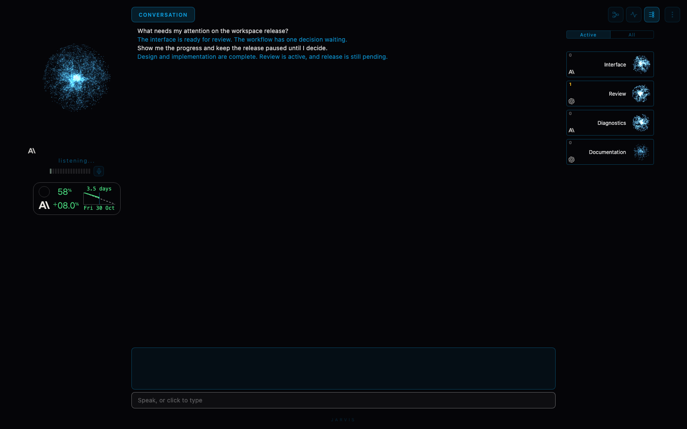
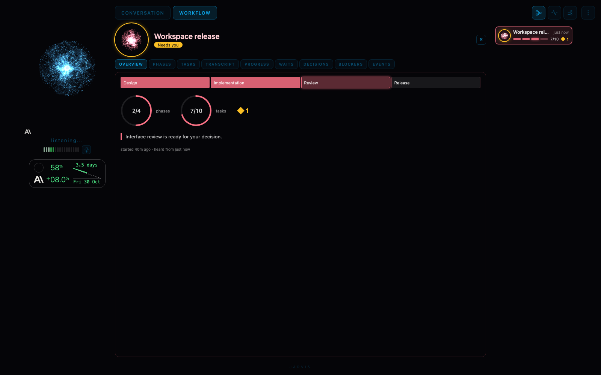
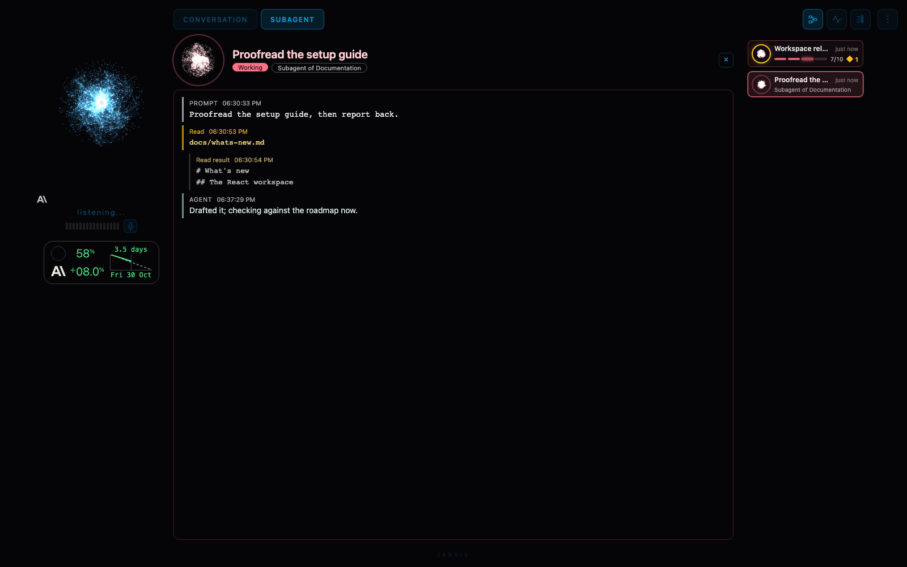
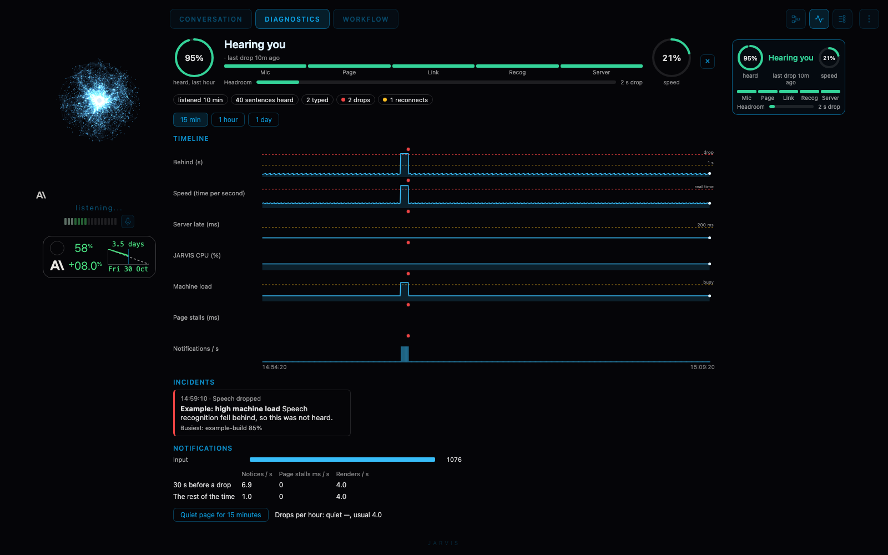

# The new JARVIS workspace

Updated 2026-11-01. This guide describes functionality present in the checkout. The [roadmap](roadmap.md) describes the development direction and successor engines.

## Conversation is the main view

The centre opens on Conversation. It combines earlier conversation with live speech, typed input, captures and expandable sources. Agent messages have delivery and reply states, so their progress can be followed in the conversation. Selecting an agent's name opens that agent's thread.

The left column holds the orb, voice status, microphone controls and brain account usage. The right panel has six labelled tabs in two rows: Folders, Agents and Queue, then Workflows, Network and Diagnostics. Detailed views open in the centre while the surrounding controls remain available.

## Folders

The centre's Folders view is a catalog of the folders JARVIS knows on this Mac. Add existing folder takes an absolute path or one starting with ~/, shows where it resolves and how JARVIS will read it, and registers it only when you say so; nothing is created, moved or changed on disk. Each folder keeps its ID through restarts and moves: if it disappears it stays listed as Missing, and Reconnect location points the same folder at its new place (a different directory has to be confirmed). Remove from catalog stops JARVIS reading it and deletes nothing.

Selecting a folder shows its location, whether it is there now, how it is read, its contents a page at a time with a preview of each file a window at a time, the Claude Code and Codex sessions whose records name it (kept after they stop) and its location history. Hidden, credential and key files are never shown; a session history folder is read as its transcripts and memory notes, shown as what was said. The Discovered list offers folders found in your sessions' own records, with Register and Ignore; seeing one grants nothing. The right panel's Folders tab is a compact list of the same folders; choosing one opens it in the centre. JARVIS can list, browse and read registered folders when you ask, and register or remove one only on your word. It tells a registered folder from a project, and looks in both before saying it can't find something you named. It can also start a run in a registered folder, to keep research there for instance: the run works in the folder's current location, and only in an ordinary folder that is there now, never in a session history or JARVIS's own notes. The run is recorded with the folder's ID. Builds still go to projects. Projects that use these folders come in a later release.

## Mute and mic off

Mute stops sending what the microphone hears, and a red "Muted" takes the level meter's place until it is pressed again. The microphone stays open while muted, so unmuting starts listening again without asking the browser for it; the browser's own recording indicator therefore stays on. The mic-off button beside it releases the microphone, which turns that indicator off, and shows "Mic off"; turning it on asks for the microphone again and takes longer than unmuting.

## Connect to your team

Settings has a Team section. Enter your team server's address and choose Sign in with GitHub: the team server's page opens, you sign in there and approve this Mac after checking the code JARVIS shows. JARVIS then shows the team, your role and when it last reached the server, checking every 30 seconds; it says so when the server can't be reached or your session has ended. The session is kept in your Keychain. Disconnect removes it and signs out on the server when it can be reached. Administrators manage members from the same section: the roster is shown as soon as the section opens, grouped as Signed in, Pending (not signed in yet) and Suspended. Adding someone says "<login> added; pending until they sign in" and lists them under Pending. When the team server refuses an add or any other member change, the page says beside it that the change did not happen and why, and a refused add keeps the person and role chosen so Add can be pressed again. Member changes need no fresh GitHub sign-in. If a code expires or you cancel, the address stays filled in, so starting again is one click. The left column's Team Server tile says Ready, Not ready, No contact or Sign in, and the Diagnostics tab has a Team server row saying the team, who you are and when JARVIS last reached it; a team server that can't be reached is shown as struggling, never down. Voice and agents carry on as before whether or not the team server is reachable. Messages between people have no switch: they work whenever this JARVIS is signed in to the team server, and while it is not, the section says that signing in turns them on. Running a team server is described in [the operator runbook](team-server.md).

## See your team's network

Once paired, JARVIS reports to the team server every five seconds, browser open or not: this Mac's CPU and memory, its brain accounts' usage and when a person last used it. The team server answers with every paired JARVIS on the team, and that answer is all the Network tab shows. Each JARVIS has one compact tile: its name, online, delayed or offline, CPU and memory, the brains' remaining allowance and pace against the week, and how long ago someone last used it (a click, a key, typing or accepted speech, never what was said or typed). Your own is outlined and marked "THIS MAC", and its figures too come from the team server, so they match what everyone else sees. Two JARVIS on two of your Macs show as two tiles. Selecting a tile opens that JARVIS in the centre.

The Team Server tile in the left column opens the server's health in the centre: its database round trip and writes, uptime, CPU and memory. When the team server can't be reached the tiles keep their last values and say they are stale, and the Team Server tile says No contact as soon as the five-second exchange fails; no JARVIS is called offline because your own link dropped.

## A reminder to sign in

JARVIS works as before when it is not signed in to a team server, and reminds you to sign in. Whenever the Team Server tile says Sign in (never paired, signed out, or part way through signing in), a line at the top of the centre area says "Sign in to your team server: messages between people and the Network view need it". It moves the view below it down rather than covering it. Sign in starts signing in again with the address you used before, opening the team server's approval page and Settings at Team where the code to check is shown; with no address saved it opens Settings at Team. Later hides the line until the page is reloaded or JARVIS restarts. Once you are signed in it goes by itself. Once each time JARVIS starts, if it is still not signed in about 30 seconds later, it also says so once, as it says any other notice: "You're not signed in to the team server, sir; messages between people are off until you are."

## Ask JARVIS about anything on the page

What the page shows or does, JARVIS can now do by voice. He can say who is on your team and who is signed in, pending or suspended, which JARVIS on the team network are online and how busy they are, and who you can message right now; ask him to write to someone and he drafts it to a name from that list. He reads what people have sent you and what you sent them, a conversation at a time, marks a message read once he has read it to you, opens, puts back, dismisses or hands the turn on a conversation in the Queue, and discards, cancels or retries one of your unsent messages, when you ask. For an administrator he looks up a GitHub account and adds, promotes, suspends, re-enables or removes a member, or ends their sessions, only on your word. He reports how each part of JARVIS is doing from the Diagnostics tab, voice input with today's figures; answers or dismisses a workflow's decision when you give the answer; runs a finished run again; and shows a folder in full, renames it, changes its role, reconnects it or checks it now, and lists, ignores or restores the folders discovery found. Signing in to the team server, API keys and restarting JARVIS stay on the page.

## Work packages

A teammate can send you work to run as a .zip in an ordinary message. When a message has one, JARVIS offers to open it. On your yes, he downloads it, unpacks it into its own folder and follows its instructions with you, running each step only when you say to. A step that needs you, such as recording your voice, opens in a Terminal window. At the end he drafts a reply with the results attached and asks you to review it, as for any other message. You can also ask him to attach a file you name to a message. The format and an example, a Spanish speech test, are in [work packages](work-packages.md).

## Getting ready to speak Spanish

JARVIS's speaking side is ready for Spanish, though nothing changes yet: English stays in force until the language setting arrives in a later release. In Spanish, Fish Audio is told the text is Latin American Spanish, so it reads numbers, dates and units the Spanish way in the same JARVIS voice. Spanish abbreviations such as Sra., Dra., Ud. and pág., and times written "3 p. m.", no longer split a sentence into separately spoken pieces. "Por supuesto", "Claro que sí" and the other Spanish counterparts of JARVIS's banned phrases are never spoken. The brain answers in Spanish, calls you "señor", says English tool results in Spanish and searches its memory in both languages before saying it doesn't have something. Messages you send agents stay in the words and language you used.

## Agents and workflows stay in context

The agent interface covers Claude Code and Codex sessions. Threads bring messages and replies together instead of requiring the user to reconstruct an exchange from separate announcements.

A workflow opens into its phases, tasks, progress, attached agent transcripts, waits, blockers, decisions and event history. Decisions can be answered in the workspace. The monitor reads reports from the sessions doing the work; it does not independently establish that every reported task is correct.

## Subagents appear with the workflows

The subagents a Claude Code session dispatches are read from the session's own files: what each was asked to do, its type, and whether its transcript shows it finished, still being written, or gone quiet. A subagent of a session attached to a running workflow is listed in that workflow's Overview, and its transcript follows the attached agents' in the Transcript tab. Any other subagent has its own row in the Workflows list, in the same style, naming the session that dispatched it; a finished one stays for a couple of minutes, as a finished workflow does. Opening the row shows its transcript in the centre. An agent with working subagents shows the count on its box in the Agents tab. These rows are worked out when read and are not added to the workflow record. Codex sessions keep no subagent files, so none are shown for them.

## Voice health has its own explanation

The Diagnostics tab summarizes whether speech is being heard, whether recognition is falling behind and how much headroom remains. Opening it reveals the pipeline, timeline, incidents, system load, notifications and grouped UI messages. The quiet-page comparison helps investigate whether interface activity accompanies drops. The displayed interval can be saved as JSON.

Above the voice summary, the Diagnostics tab lists each major subsystem with its state: communications with Claude Code and Codex sessions, voice input, the brain, voice output, the tool channel, the workflow monitor and the page's own connection. Communications count as down when the session watcher stops, messages fail to reach two or more different sessions in a row, or the loops that collect session messages and needs boards stop. A down subsystem is shown in red, the Diagnostics tab turns red whichever tab is open, and JARVIS says when communications go down and when they recover. Selecting a subsystem opens its checks in the centre.

Speech input currently uses local Kroko streaming recognition through sherpa-onnx. Fish Audio remains the speaking voice. Local recognition does not make the conversational provider or speech output offline.

These captures render the real frontend with sample records; they are not production measurements.

## More than one conversational provider

Claude and Codex brain providers share the application interface. Settings expose provider configuration, and brain account usage appears in the left column. Development runs retain a separate execution path; conversational provider selection does not switch every execution engine.

## Packaged application layout

Python modules now live under `jarvis/`. Start the backend with `python -m jarvis`; the frontend build is packaged under `jarvis/web`. Configuration and data stay outside installed package files. The [README](../README.md#run-the-workspace) contains the current checkout setup commands.

## What follows

The priorities are a complete conversation-centred workspace, reliable voice under concurrent load, understandable agent coordination and the path from the Prototype Engine to Denice. Speech-output alternatives and eye tracking remain evaluations. See the [roadmap](roadmap.md) for status distinctions.

## When explaining this by voice

Answer the user's question from the current interface and relevant roadmap item. Keep shipped functionality separate from future work. Do not describe a planned engine or evaluated speech model as already installed.
