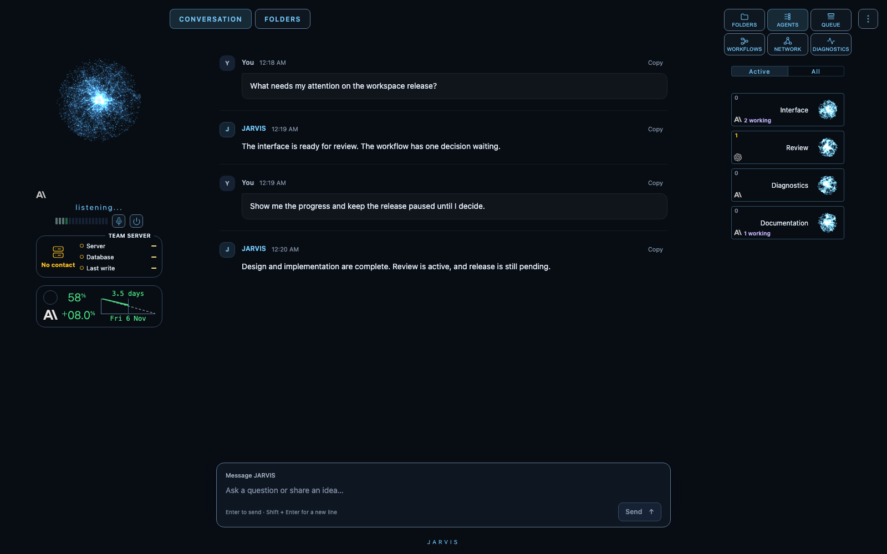
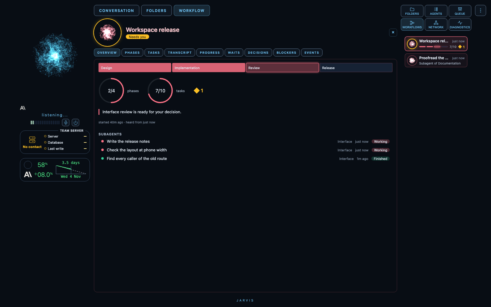
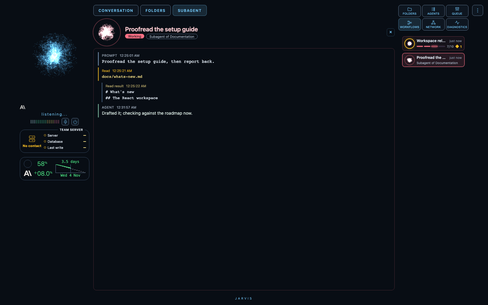
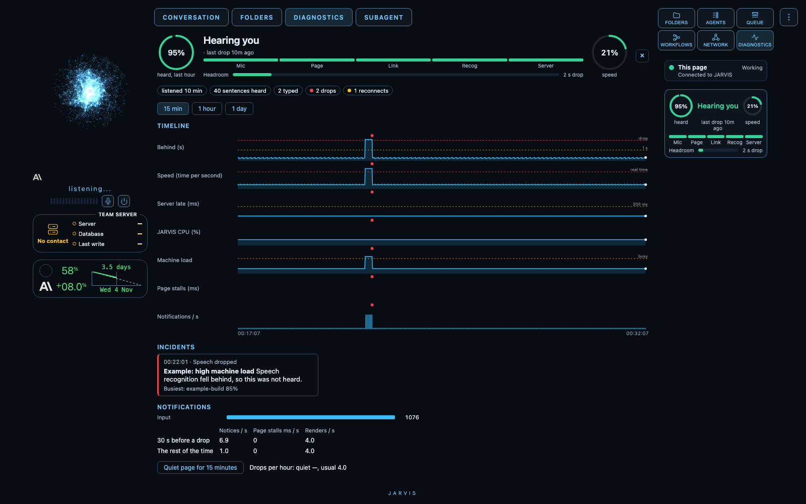

# The new JARVIS workspace

Updated 2026-11-13. This guide describes functionality present in the checkout. The [roadmap](roadmap.md) describes the development direction and successor engines.

## Closing or replacing a package ends what waited on it

Setting a package aside now ends everything that waited on it, as signing it
off always did: a Work item's piece waiting on the package moves on, a
workflow's wait on it ends, and the item's "Is it clear?" question about it
closes, shown as closed when you set its package aside rather than as an
answer. When an agent sends a newer version that replaces an open package,
whatever waited on the old one now waits on the newer one, which is the one
you can open, and the newer one stays with the same Work item. Waits left
open by packages closed or replaced before this update are cleared the next
time JARVIS starts. An agent may end a wait it placed itself; a wait JARVIS
or another agent placed still ends only with your answer.

The check a decision package passes before it reaches you now measures
every picture on every slide, not only the options' pictures, at both
screen sizes. An SVG picture must say its size (width and height in pixels
on its `<svg>`); one that does not is refused before the package is built,
since it can show as a blank slide.

## Every setting is in Settings

Everything you can choose about JARVIS is now a control in Settings, and
nothing asks you to edit a `.env` file or set an environment variable. New
sections hold what used to live only in `.env`: Agents (how long a run may
take or stay silent, skipping permission prompts, the time to cancel a send,
the session homes JARVIS watches), Projects (where new projects go and where
JARVIS looks for them) and Safety (refusing to act after reading others'
words). You gains the weather place and units and the browser JARVIS opens;
Voice the speech models folder and muting the microphone while JARVIS
speaks; Brains the effort, turn limit, compaction point, program paths and
usage reading; Knowledge the run context, the folder catalog and the engine's
memory; Team the local team servers; Server the address, port, HTTPS,
starting the brain, extra page origins and the API console, with Restart now.
A start-up setting says it takes effect at the next start, and says so again
once changed. If a new address or port cannot be used, JARVIS goes back to the
last one that worked. Ask JARVIS about any of them, or to change one; the
program paths, the address, the extra origins and the Fish key are changed
only by your click. The Fish key is kept in your Keychain. The first start
copies whatever your old `.env` held into Settings, once, and says when in
Settings → Server; after that the file is not read.

## The knowledge index builds itself, and says how far it is

Settings → Knowledge (and the Knowledge view) shows the index being built:
which pass it is on, how many items and how many sections have their
vectors out of how many, and about how long the rest will take; "paused while you talk" while you
and JARVIS are speaking, and "paused in Settings" when you pause indexing
there. It builds your messages, conversation and Work first, newest first,
then JARVIS's notes, then your folders' files, most recently changed first.
The first pass gives every item one vector, so everything can be found by
meaning early; each pass after it adds the next sixteen sections of every
file, so coverage rises evenly across files, until every section of every
file is indexed. Nothing is left out, however long the file; a file that
changes goes back to the first pass.
It uses half of one processor core whatever else the Mac is doing, so it
always moves and never slows the Mac, and a restart carries on where it
stopped. A search made while it is
still building says that meaning search may miss what is not indexed yet.
Ask JARVIS "how far is the knowledge index?" for the same figures.

JARVIS's server also does far less on its own when no page is open: it no
longer reads every package, the whole package inbox or the whole voice
record every few seconds, and it asks each Codex session for its folder once.

## Agents on Codex as well as Claude

JARVIS can start an agent on Codex as well as on Claude Code: an agent run, a build or an agent package goes on the Codex app server already running on this Mac, in your own Codex setup, never asking and with no sandbox, as Claude agents run. JARVIS watches it, stops it and retries it on the same engine. Say "on Codex" or "on Claude" for one agent; otherwise Settings → Brains decides, under "Who runs each kind of agent": for the package author, agent runs, builds and agent packages, a brain and one of its models, the same as the agent asking, or the brain with the least token stress. Token stress is the plus or minus the brain board shows against the week's pace, shown there beside each brain; "Override if the chosen brain is in token stress" moves an agent off a brain that is behind its pace. JARVIS refuses to start a Codex agent on an app server version it has not been checked against, and says so.

## Two appearances across the app

Settings → Server → Appearance offers Classic Refined, a quiet navy palette, and
Graphite, a neutral dark palette with a soft blue-violet accent. Conversation,
folders, agent threads, Queue/review, workflows, Network, Diagnostics, settings
and the run dashboard share readable text, surfaces and focus treatments. Tim's
layout, type sizes, controls and interactions remain in place. The orbs and
semantic state colors keep their identities.

The choice is saved in this browser, applies before the page is drawn and follows
changes made in another JARVIS tab on the same origin. It does not change server
settings or anyone else's appearance.

## Conversation is the main view

The centre opens on Conversation. It combines earlier conversation with live speech, typed input, captures and expandable sources. Agent messages have delivery and reply states, so their progress can be followed in the conversation. Selecting an agent's name opens that agent's thread.

The left column holds the orb, the team server's health and brain account usage. The microphone controls (Start listening, Mute, Mic off) sit at the lower right of the Conversation's message box, right of Send, with Stop and the voice health dot to Send's left (on any other centre view the microphone controls stay in the same lower-right corner); what JARVIS is doing (thinking, speaking) is the row above the message box. The right panel has six labelled tabs in two rows: Folders, Agents and Queue, then Work, Network and Diagnostics. Detailed views open in the centre while the surrounding controls remain available.

## Your records move into the new engine once

The first start after the update that brought the knowledge engine's records
moves them out of `data/jarvis.db` into the engine (`data/knowledge`): it
copies every table, checks the copy against the file, and checks that the
file can be made again from the engine. On a large file this takes a few
minutes (about two and a half for 240,000 rows). JARVIS answers meanwhile: the
page shows "Moving your records into the new engine", the step it is on
(copying, checking, checking the way back) and about how long is left, and
JARVIS's voice and agents wait until it is done. JARVIS first checks there is
enough free disk for the engine and its temporary copies, and refuses with how
much it needs if there is not, before anything is written.

`data/jarvis.db` is never changed by the move; it stays beside the engine.

**A slow Mac no longer stops the move.** A busy machine can make one write of
the copy take longer than usual; the move now waits for it, and a write that
still times out is checked and tried again (never written twice) before the
move gives up and says why.

**An older `jarvis.db` moves too.** A file from before the newest message
columns and agent keys used to fail the check ("conversation_items: ... first
difference ... (changed)") although nothing differed: the check compared it
with today's columns. It now reads the records back in the file's own shape.

**Stopping during the move is safe.** Ctrl-C, closing the terminal or shutting
the Mac down part way loses nothing: the next start clears what was copied and
copies again from the beginning, even if `jarvis.db` changed in between.

### If the records move fails

The page says that it failed and why, and the server stays up saying so. What
to do depends on the step that failed:

- **Stopped part way, or a write that timed out** (the copy step, "timed out"
  or a lost connection in the reason): start JARVIS again; the next start
  clears what was copied and copies again from the beginning.
- **The check or the check back failed** (the reason says the records differ
  from jarvis.db, or names a table): starting again repeats the same check on
  the same file and fails the same way. Report it with the reason shown, and
  go back to the version you had before until a fix is in.

To go back to the version you had before:

1. Stop JARVIS.
2. Find the version you had: `git reflog` lists the update as
   `merge ...: Fast-forward`; the line below it is the commit you had.
3. Go back to it: `git reset --keep <that commit>`. If the update changed the
   dependencies, install them again: `.venv/bin/pip install -r requirements.txt`
   and `cd frontend && npm ci` (and `npm run build` if the page is served from
   built files).
4. Move the engine's folder aside, since the version before may not read it:
   `mv data/knowledge data/knowledge.moved-aside`.
5. Start JARVIS. It runs on `data/jarvis.db`, exactly as before the update.

After a move that succeeded, JARVIS writes its records to the engine only. To
take what it wrote since back to an earlier version, write the records out as a
SQLite file first, with JARVIS running:
`.venv/bin/python -m jarvis.knowledge export-sqlite --out data/jarvis-from-engine.db`,
then stop it, go back as above and put that file in place of `data/jarvis.db`
(keep the old one).

## Every message from an agent, on its Work item

An agent reaches you one way: a signed message about the Work item it belongs to, shown on that item's Messages tab, or in the Inbox (the tab that was Queue) when it is about no item. Every decision comes as a package with its background, never a bare question; Open shows it and you answer there. Needs boards and message files are gone. Ask JARVIS "what's new?" and it reads your new messages in the Inbox's order, each item's first; "read it", "next", "open it" (a decision package's story is told and waits for your answer) and "reply" act on the message you are on. A message read to you to its end (Read, "read it", or JARVIS reading an agent's answer to you) is marked read, and leaves the Inbox's new list for its Read section, closed under it; a message you are done with leaves the Inbox. Hide messages, beside "From agents", folds them away so people's messages stay in view; this browser remembers it.

## Usage history: each brain's limits over time

Clicking a brain's box in the left column opens that brain's weekly usage history in the centre, titled with its name ("Anthropic usage"); each brain has its own view. It shows the same weekly burn-down as the box, week after week: this week first, then Earlier week and Later week move through the weeks before it in order, and This week comes back. Each week is drawn across its whole span: what is left of the week, all of it at the top, against the dashed straight line from all left at the week's start to none at its reset, green while ahead of that line and red while behind it, with the reset marked at the week's end. The readings are joined as one line, across any stretch without one; nothing unmeasured is drawn as zero. Above the chart is the reading in the box's terms: what is left and how far ahead of or behind the line it is (for an earlier week, what it ended with). Hovering says the time and what was left. Only the week is kept: the five-hour window's history is not. Every weekly reading is kept for two weeks, then one summary per hour for good. JARVIS can read the same history for either brain when you ask (`usage_history`).

## Take over: a workflow or a package gets the page

A workflow, a subagent or a page package shown in the centre can take over the page: Take over beside its ×, Option+Shift+T, or asking JARVIS. The centre widens over the right panel, which folds to a rail of its six tab icons (each keeps its mark; an icon opens its tab over the takeover, closed by Escape or a click outside). The centre tabs give way to one bar: the item's name, what JARVIS is doing, the notices as chips, a chip for a message waiting for your yes (it opens the message as a sheet; saying yes works as always), the microphone with Stop and the health dot, and Restore layout. Restore layout, the same key (inside a package's page too), showing another centre view, opening another package or closing the item brings the normal layout back, and a reload always starts normal. A package whose package.json says `"layout": "wide"` is made for it and offers Take over; its page is told the room it has.

## Work: who is doing each piece

The tab that was Workflows is now Work. Each item of work in progress shows its title, its state and one useful update, with an open decision first. An item wraps a ZIP work package or a folder on this Mac; JARVIS only checks that it is there and never opens or runs it. Selecting an item opens it in the centre, with the list still in view: its source, its latest update, its decisions to answer, and its pieces, each naming exactly who is on it (an agent by its name, a run, a workflow, or you). Close goes back to Conversation. Agents report to it with `work_report.py` and an access key in the `work` category, and you can ask JARVIS what is in progress or answer a decision by voice. The Workflows list is still there, under the Work list.

## Nothing is sent until you say yes

A message JARVIS reads back to you, to an agent or to a person, now goes only
once you approve it: the first thing you say after hearing it read back in full
must be a plain yes ("yes", "go ahead", "do it"), or you press Send on its box.
A read-back you skipped or cut short, a yes said before the reading, or a yes
after you said something else does not count, and a change to the message
needs a new read-back. JARVIS enforces this itself; he cannot send in the same
breath as the read-back.

JARVIS now reads a message back as soon as he knows who it is for, without
asking first, and the read-back opens by naming them ("To chitauri."). Your yes
covers that recipient only: "send it to chitauri" approves it only when
chitauri is who the read-back named, sending it anywhere else is refused, and
changing who it is for needs a new read-back and a new yes.

## Settings in the centre

Settings opens in the centre as a tab beside Conversation, from the ⋮ menu (Check for updates opens it at Updates), and no longer covers the orb or the side columns. Its sections are in the order you come to them: You, Voice and language, Brains, Team, Updates and Server, with a row of their names under the title to jump to each. Each row is a short label and its controls; a state is shown only when it needs your attention, such as a brain check that is failing or a server that is not answering. With no Fish Audio key, first-time setup still opens by itself and walks through Voice and language, then You. JARVIS can point at any Settings control when you ask where something is.

## Folders

The centre's Folders view is a catalog of the folders JARVIS knows on this Mac. Add existing folder takes an absolute path or one starting with ~/, shows where it resolves and how JARVIS will read it, and registers it only when you say so; nothing is created, moved or changed on disk. Each folder keeps its ID through restarts and moves: if it disappears it stays listed as Missing, and Reconnect location points the same folder at its new place (a different directory has to be confirmed). Remove from catalog stops JARVIS reading it and deletes nothing.

Selecting a folder shows its location, whether it is there now, how it is read, its contents a page at a time with a preview of each file a window at a time, the Claude Code and Codex sessions whose records name it (kept after they stop) and its location history. Hidden, credential and key files are never shown; a session history folder is read as its transcripts and memory notes, shown as what was said. The Discovered list offers folders found in your sessions' own records, with Register and Ignore; seeing one grants nothing. The right panel's Folders tab is a compact list of the same folders; choosing one opens it in the centre. JARVIS can list, browse and read registered folders when you ask, and register or remove one only on your word. It tells a registered folder from a project, and looks in both before saying it can't find something you named. It can also start a run in a registered folder, to keep research there for instance: the run works in the folder's current location, and only in an ordinary folder that is there now, never in a session history or JARVIS's own notes. The run is recorded with the folder's ID. Builds still go to projects. Projects that use these folders come in a later release.

## Mute and mic off

Mute stops sending what the microphone hears, and a red "Muted" takes the level meter's place until it is pressed again. The microphone stays open while muted, so unmuting starts listening again without asking the browser for it; the browser's own recording indicator therefore stays on. The mic-off button beside it releases the microphone, which turns that indicator off, and shows "Mic off"; turning it on asks for the microphone again and takes longer than unmuting.

## Connect to your team

Settings has a Team section. Enter your team server's address and choose Sign in with GitHub: the team server's page opens, you sign in there and approve this Mac after checking the code JARVIS shows. JARVIS then shows the team, your role and when it last reached the server, checking every 30 seconds; it says so when the server can't be reached or your session has ended. The session is kept in your Keychain. Disconnect removes it and signs out on the server when it can be reached. Administrators manage members from the same section: the roster is shown as soon as the section opens, grouped as Signed in, Pending (not signed in yet) and Suspended. Adding someone says "<login> added; pending until they sign in" and lists them under Pending. When the team server refuses an add or any other member change, the page says beside it that the change did not happen and why, and a refused add keeps the person and role chosen so Add can be pressed again. Member changes need no fresh GitHub sign-in. If a code expires or you cancel, the address stays filled in, so starting again is one click. The left column's Team Server tile says Ready, Not ready, No contact or Sign in, and the Diagnostics tab has a Team server row saying the team, who you are and when JARVIS last reached it; a team server that can't be reached is shown as struggling, never down. Voice and agents carry on as before whether or not the team server is reachable. Messages between people have no switch: they work whenever this JARVIS is signed in to the team server, and while it is not, the section says that signing in turns them on. Running a team server is described in [the operator runbook](team-server.md).

## See your team's network

Once paired, JARVIS reports to the team server every five seconds, browser open or not: this Mac's CPU and memory, its brain accounts' usage and when a person last used it. The team server answers with every paired JARVIS on the team, and that answer is all the Network tab shows. Each JARVIS has one compact tile: its name, online, delayed or offline, CPU and memory, the brains' remaining allowance and pace against the week, and how long ago someone last used it (a click, a key, typing or accepted speech, never what was said or typed). Your own is outlined and marked "THIS MAC", and its figures too come from the team server, so they match what everyone else sees. Two JARVIS on two of your Macs show as two tiles. Selecting a tile opens that JARVIS in the centre.

The Team Server tile in the left column opens the server's health in the centre: its database round trip and writes, uptime, CPU and memory. When the team server can't be reached the tiles keep their last values and say they are stale, and the Team Server tile says No contact as soon as the five-second exchange fails; no JARVIS is called offline because your own link dropped.

## A reminder to sign in

JARVIS works as before when it is not signed in to a team server, and reminds you to sign in. Whenever the Team Server tile says Sign in (never paired, signed out, or part way through signing in), a line at the top of the centre area says "Sign in to your team server: messages between people and the Network view need it". It moves the view below it down rather than covering it. Sign in starts signing in again with the address you used before, opening the team server's approval page and Settings at Team where the code to check is shown; with no address saved it opens Settings at Team. Later hides the line until the page is reloaded or JARVIS restarts. Once you are signed in it goes by itself. Once each time JARVIS starts, if it is still not signed in about 30 seconds later, it also says so once, as it says any other notice: "You're not signed in to the team server, sir; messages between people are off until you are."

## Ask JARVIS about anything on the page

What the page shows or does, JARVIS can now do by voice. He can say who is on your team and who is signed in, pending or suspended, which JARVIS on the team network are online and how busy they are, and who you can message right now; ask him to write to someone and he drafts it to a name from that list. He reads what people have sent you and what you sent them, a conversation at a time, marks a message read once he has read it to you, opens, puts back, dismisses or hands the turn on a conversation in the Queue, and discards, cancels or retries one of your unsent messages, when you ask. For an administrator he looks up a GitHub account and adds, promotes, suspends, re-enables or removes a member, or ends their sessions, only on your word. He reports how each part of JARVIS is doing from the Diagnostics tab, voice input with today's figures; answers or dismisses a workflow's decision when you give the answer; runs a finished run again; and shows a folder in full, renames it, changes its role, reconnects it or checks it now, and lists, ignores or restores the folders discovery found. Signing in to the team server, API keys and restarting JARVIS on its own stay on the page.

## Update from GitHub

A JARVIS running from a checkout of the GitHub repository can update itself, to the version you choose. Settings has an Updates section, which the ⋮ menu's Check for updates opens. It says which version is running ("Running PR 39: Find the running server from the workflow reporter" and its commit) and lists every newer version on main, newest first: each is a merged pull request, with its number, title, date, commit and whether its tests passed, and the newest is tagged LATEST. Only a version whose tests passed can be chosen; the others are listed greyed, saying they can be chosen once their tests pass or can't be chosen because they failed. The newest one that passed starts chosen. Install and restart asks once more, saying how many pull requests the choice brings in, that the page reloads by itself, that a failed step moves JARVIS back and changes nothing, and that going back to an older version is not offered; "Yes, install PR 41" goes ahead. A refusal is said in red under the list. JARVIS installs the Python requirements or the page's packages when they changed, rebuilds the page when it is served from built files, and restarts; the page reloads itself as it does after Restart Server. If the page's packages changed while you run `npm run dev`, it says to restart that. It refuses, and says why, when the checkout is not on main, has changes or commits of its own, or has untracked files the update would overwrite. Ask JARVIS "is there an update?" and he lists the versions; tell him to update himself, to the latest or to "pull request 41": he says he is updating, and is back on the new code a few seconds later. From a terminal, `.venv/bin/python -m jarvis.update` does the same, `--to 41` installs pull request 41's version, and `--check` only lists the versions; with JARVIS stopped it only updates. It finds the running JARVIS on whatever address and port it was started with, and if that JARVIS is running but cannot be reached, it stops without updating. An installed copy is not offered the update and says so.

## Work packages

A teammate can send you work to run as a .zip in an ordinary message. When a message has one, JARVIS offers to open it. On your yes, he downloads it, unpacks it into its own folder and follows its instructions with you, running each step only when you say to. A step that needs you, such as recording your voice, opens in a Terminal window. At the end he drafts a reply with the results attached and asks you to review it, as for any other message. You can also ask him to attach a file you name to a message. The format and an example, a Spanish speech test, are in [work packages](work-packages.md).

A package can also run two other ways. An agent package hands its brief to a coding agent that works in the package's folder on its own: on your yes JARVIS starts it, tells you when it has finished (or failed), and asks whether to draft the reply with its results. A page package is its own small web page: on your yes JARVIS opens it in the centre. You can also open any package yourself with Open package on its file in the Queue; a page package then opens in the centre at once, and its file has Open page from then on. A package zip that is a file on your Mac opens the same way: ask JARVIS to open the package at its path, or choose the .zip in a registered folder in the Folders view and press Open package. An open package page stays open when the page reloads, until you close it. The page runs in a sealed frame that cannot reach the rest of JARVIS; it can save its results into the package's folder and, when it asks, hear JARVIS's microphone, including while JARVIS is muted. Examples of both are in [work packages](work-packages.md).

## Speak Spanish to JARVIS

Settings, Voice now has a Language control: English or Español. Español can be chosen once the Spanish speech model is installed; until then the row below it offers "Download (124 MB)" and shows how the download is going, and the download is checked against the SHA-256 the sherpa-onnx release publishes before anything is unpacked. Changing the language reloads the speech model, which takes a few seconds, and JARVIS then says so in the new language: "Ahora hablo en español, señor." The choice is kept by JARVIS itself, not in your .env, and holds after a restart. By voice, say exactly "switch to Spanish" while he is in English, or "cambia a inglés" while he is in Spanish; only the whole phrase counts, and Settings always works, so a misheard phrase cannot leave you stuck. You can also ask JARVIS to change the language or to download the model. The Honorific setting in Settings, You is now used, and has Señor as a choice: Sir means "sir" in English and "señor" in Spanish, and None means no form of address. English stays the default and works as before.

JARVIS reads accented words whole. Before, "sí" was heard as the letter "s" and "espérate" as two fragments, so no Spanish yes, no or cancel could ever count. In Spanish: sí, claro, adelante, hazlo, dale or "de acuerdo" to say yes; no, espera, luego, después, nunca, negativo or todavía to say no; espera, espérate, cancela, alto or detente to stop him; repite or otra vez to hear the last answer again; and exactly "empezar de cero" to clear the conversation, still confirmed with a yes. Agent names and memories with accents are found with or without them.

In Spanish, Fish Audio is told the text is Latin American Spanish, so it reads numbers, dates and units the Spanish way in the same JARVIS voice. Spanish abbreviations such as Sra., Dra., Ud. and pág., and times written "3 p. m.", no longer split a sentence into separately spoken pieces. "Por supuesto", "Claro que sí" and the other Spanish counterparts of JARVIS's banned phrases are never spoken. The brain answers in Spanish, calls you "señor", says English tool results in Spanish and searches its memory in both languages before saying it doesn't have something. Messages you send agents stay in the words and language you used.

## Agents and workflows stay in context

The agent interface covers Claude Code and Codex sessions. Threads bring messages and replies together instead of requiring the user to reconstruct an exchange from separate announcements.

A workflow opens into its phases, tasks, progress, attached agent transcripts, waits, blockers, decisions and event history. Decisions can be answered in the workspace. The monitor reads reports from the sessions doing the work; it does not independently establish that every reported task is correct.

## Subagents appear with the workflows

The subagents a Claude Code session dispatches are read from the session's own files: what each was asked to do, its type, and whether its transcript shows it finished, still being written, or gone quiet. A subagent of a session attached to a running workflow is listed in that workflow's Overview, and its transcript follows the attached agents' in the Transcript tab. Any other subagent has its own row in the Workflows list, in the same style, naming the session that dispatched it; a finished one stays for a couple of minutes, as a finished workflow does. Opening the row shows its transcript in the centre. An agent with working subagents shows the count on its box in the Agents tab. These rows are worked out when read and are not added to the workflow record. Codex sessions keep no subagent files, so none are shown for them.

## Voice health has its own explanation

The Diagnostics tab summarizes whether speech is being heard, whether recognition is falling behind and how much headroom remains. Opening it reveals the pipeline, timeline, incidents, system load, notifications and grouped UI messages. The quiet-page comparison helps investigate whether interface activity accompanies drops. The displayed interval can be saved as JSON.

Above the voice summary, the Diagnostics tab lists each major subsystem with its state: communications with Claude Code and Codex sessions, voice input, the brain, voice output, the tool channel, the workflow monitor and the page's own connection. Communications count as down when the session watcher stops or messages fail to reach two or more different sessions in a row. A down subsystem is shown in red, the Diagnostics tab turns red whichever tab is open, and JARVIS says when communications go down and when they recover. Selecting a subsystem opens its checks in the centre.

Speech input currently uses local Kroko streaming recognition through sherpa-onnx. Fish Audio remains the speaking voice. Local recognition does not make the conversational provider or speech output offline.

These captures render the real frontend with sample records; they are not production measurements.

## Two speech models, one at a time

Speech input knows two models, English and Spanish, and holds one in memory at a time. Besides Settings, the Spanish model (124 MB) can be installed with `.venv/bin/python scripts/setup_speech_input.py --language es`. When the language changes, whatever was being said at that moment is not heard, the page says speech recognition is switching and listens again once the model has loaded, and the voice record notes the switch and how long it took. `JARVIS_STT_MODEL_DIR`, if you set it, now names the folder that holds one folder per model.

## More than one conversational provider

Claude and Codex brain providers share the application interface. Settings expose provider configuration, and brain account usage appears in the left column. Development runs retain a separate execution path; conversational provider selection does not switch every execution engine.

## Packaged application layout

Python modules now live under `jarvis/`. Start the backend with `python -m jarvis`; the frontend build is packaged under `jarvis/web`. Configuration and data stay outside installed package files. The [README](../README.md#run-the-workspace) contains the current checkout setup commands.

## What follows

The priorities are a complete conversation-centred workspace, reliable voice under concurrent load, understandable agent coordination and the path from the Prototype Engine to Denice. Speech-output alternatives and eye tracking remain evaluations. See the [roadmap](roadmap.md) for status distinctions.

## When explaining this by voice

Answer the user's question from the current interface and relevant roadmap item. Keep shipped functionality separate from future work. Do not describe a planned engine or evaluated speech model as already installed.
